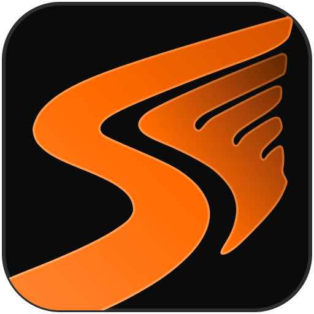

<div align="center">
  
  <h1>Sprint</h1>
  <p>Sim racing telemetry — live data on your wheel, a plan for every race, your laps to compare.</p>
</div>

Sprint is a desktop app for sim racers. It reads live telemetry from the game, renders a dash you
design onto the USB screen in your wheel, plans race weekends against your own lap history, and
compares laps trace by trace, yours or ones a friend sent as a lap file. A cloud API and web app
hold your sessions and let a race engineer follow along.

Supported game: **Le Mans Ultimate**. Supported screens: **VoCore M-PRO** and **USBD480 NX** over
WinUSB.

## What it does

- **Dashes** — build wheel dashes from a widget catalog; the editor preview, the on-screen display
  and the wheel show the same render.
- **Devices** — add wheels and screens, set rotation, offsets and what each screen shows: a dash, a
  flag display, a lap timer or a rear-view mirror of a desktop region. A browser display shows a
  dash in any browser or VR overlay tool on the same PC.
- **Session planner** — plan qualifying and race, pick targets from your recorded laps, and get them
  on the wheel from the next lap.
- **Analysis** — overlay any two laps, your own, imported or shared.
- **Setups** and **Race engineer** — keep setup variants; let an engineer stage and push changes.

## Installing

Windows 10/11: download `sprint-<version>-setup.exe` from the
[latest release](https://github.com/kratofl/sprint/releases) and run it. It installs for your user
without an admin prompt and keeps itself up to date; turn that off under Settings → Updates. The
installer is not code-signed yet, so Windows may warn first (More info → Run anyway).

## Building from source

It also builds and runs on macOS for development, without game telemetry or USB screens.
Requirements:

| Tool | Version |
| --- | --- |
| [.NET SDK](https://dotnet.microsoft.com/download) | 10.0.x |
| [Node.js](https://nodejs.org) | ≥ 20 |
| [pnpm](https://pnpm.io) | ≥ 9 |
| [Rust](https://rustup.rs) | stable, with `rustup target add wasm32-unknown-unknown` |
| Make | any |
| [Docker](https://www.docker.com) | for the API stack only |

```sh
pnpm install
make dev-app        # desktop app: Vite + Electron + native host
make build-app      # packaged app -> app/build/bin/
```

The API and web app run with `cp .env.example .env; make docker-up` (web on `:3000`, GraphQL on
`:8080/graphql`). `make help` lists every target.

USB screens need the WinUSB driver bound. A screen already working with SimHub works as-is;
otherwise bind it with the vendor tool or [Zadig](https://zadig.akeo.ie).

## Repository

| Path | What |
| --- | --- |
| `app/` | Desktop app: .NET 10 native host + Electron/React UI |
| `api/` | .NET 10 GraphQL API (Postgres + InfluxDB) |
| `web/` | Next.js web app |
| `packages/` | Shared TypeScript types, design tokens, the dash renderer |
| `docs/` | Architecture notes, runbooks, design system — [index](docs/README.md) |

This repository is written by coding agents; [`AGENTS.md`](AGENTS.md) is where they start.

## License

[GPL-3.0](LICENSE)
