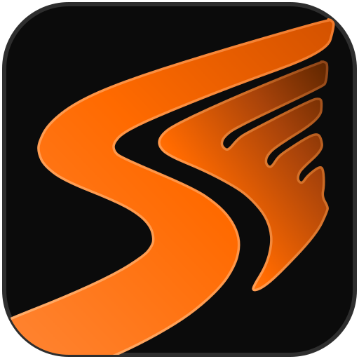
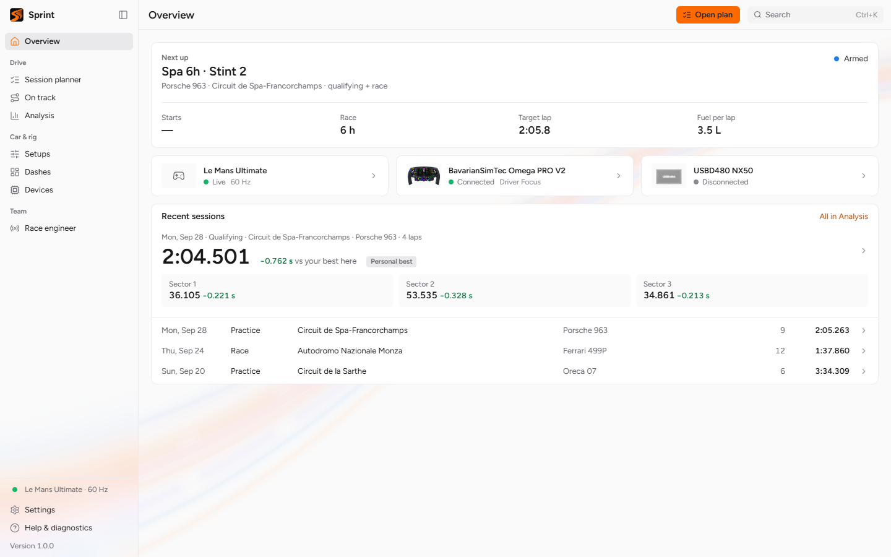
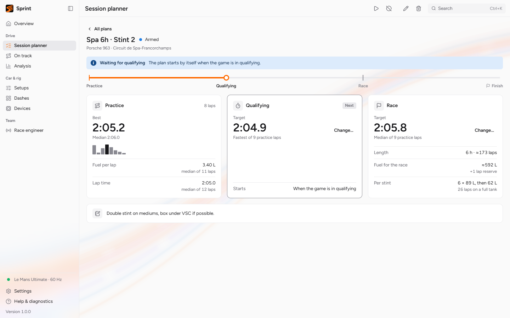
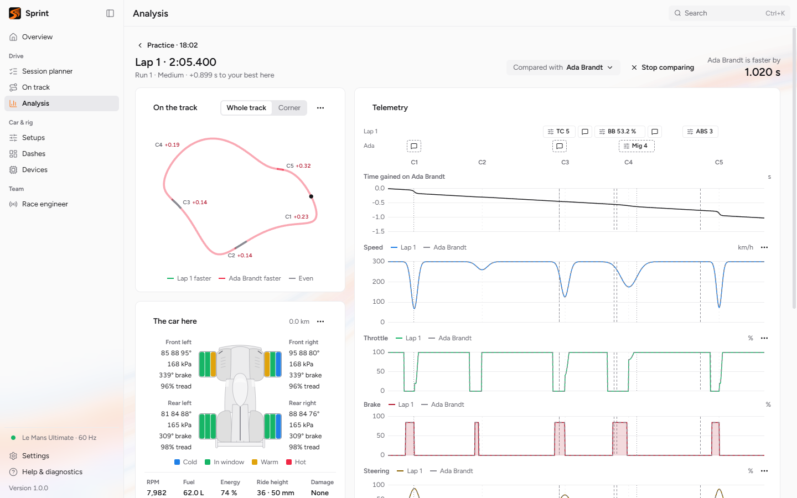
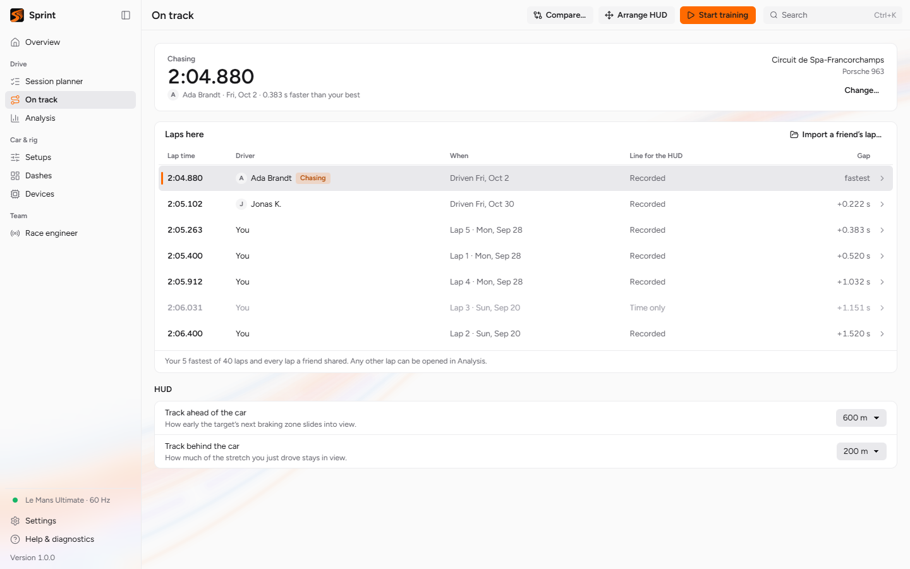
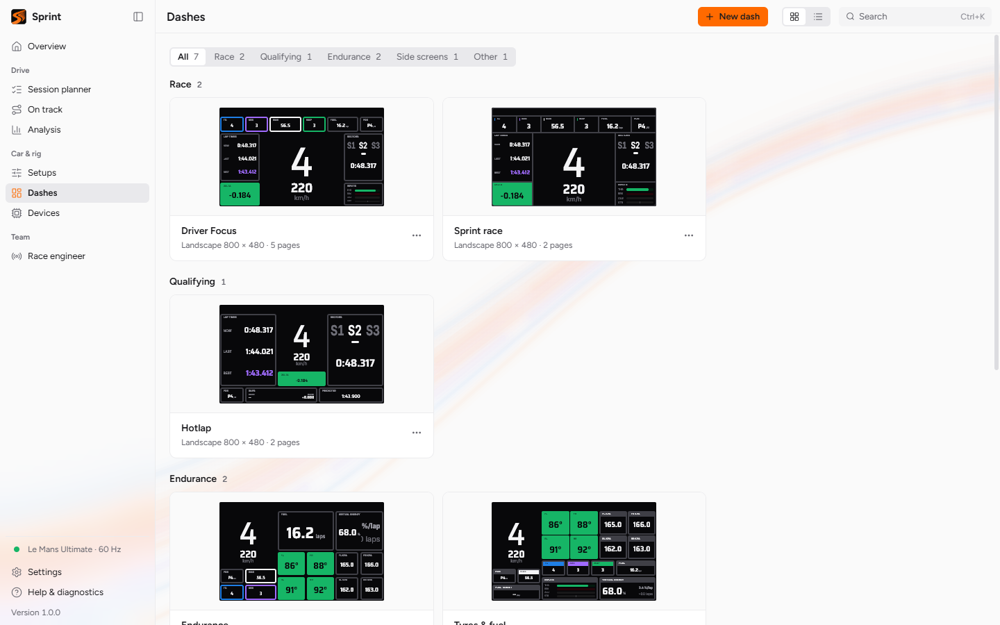
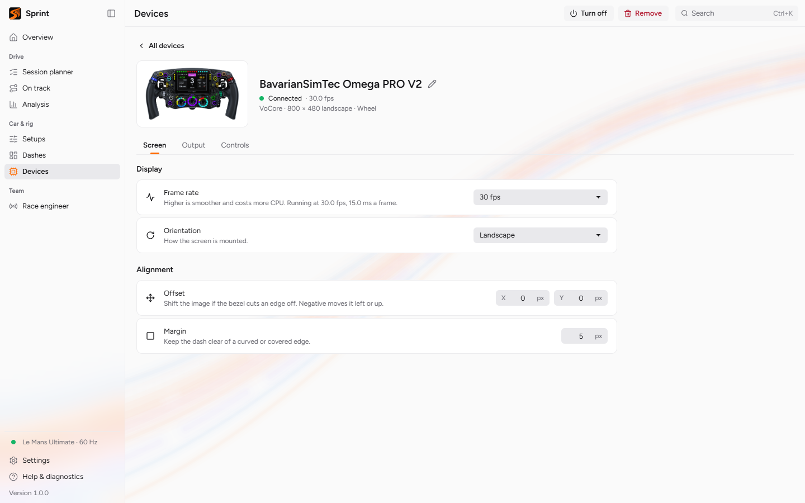
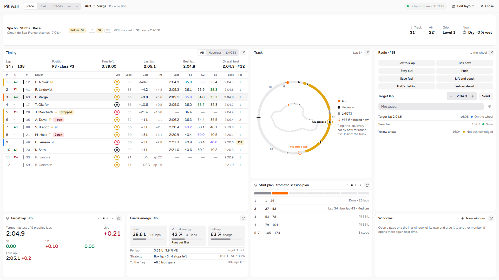

<div align="center">
  
  <h1>Sprint</h1>
  <p>Sim racing telemetry — live data on your wheel, a plan for every race, your laps to compare.</p>
</div>

Sprint is a desktop app for sim racers. It reads live telemetry from the game, renders a dash you
design onto the USB screen in your wheel, plans race weekends against your own lap history, and
compares laps trace by trace, yours or ones a friend sent as a lap file. A cloud API and web app
hold your sessions and let a race engineer follow along.

Supported game: **Le Mans Ultimate**. Supported screens: **VoCore M-PRO** and **USBD480 NX** over
WinUSB.

## What it does

<picture>
  <source media="(prefers-color-scheme: dark)" srcset="assets/screenshots/overview-dark.png" />
  
</picture>

### Plan the race

The session planner picks qualifying and race targets from your recorded laps, works out the fuel
for every stint, and puts the targets on your wheel from the next lap.

<picture>
  <source media="(prefers-color-scheme: dark)" srcset="assets/screenshots/session-plan-dark.png" />
  
</picture>

### Compare your laps

Analysis opens a lap with its line on the track and every channel the car recorded. Compare it with
any other lap, your own, imported or one a friend sent as a lap file, and see where it gains and
loses, corner by corner. On track picks a lap to chase and draws it over the game while you drive.

<picture>
  <source media="(prefers-color-scheme: dark)" srcset="assets/screenshots/analysis-dark.png" />
  
</picture>

<picture>
  <source media="(prefers-color-scheme: dark)" srcset="assets/screenshots/on-track-dark.png" />
  
</picture>

### Your dash, on your wheel

Build wheel dashes from a widget catalog; the editor, the on-screen preview and the wheel show the
same picture. Add wheels and screens, set rotation, offsets and what each one shows: a dash, a flag
display, a lap timer or a rear-view mirror of a desktop region. A browser display shows a dash in
any browser or VR overlay tool on the same PC.

<picture>
  <source media="(prefers-color-scheme: dark)" srcset="assets/screenshots/dashes-dark.png" />
  
</picture>

<picture>
  <source media="(prefers-color-scheme: dark)" srcset="assets/screenshots/device-dark.png" />
  
</picture>

### A race engineer on the pit wall

Link two PCs directly, no server needed, and your engineer gets a pit wall: timing, the track,
flags and race control, fuel and stint plan, the car and live telemetry traces, arranged as they
like across one or more screens. Box now, a new target lap or any short message goes straight to
your wheel, and the engineer sees when you've read it.

<picture>
  <source media="(prefers-color-scheme: dark)" srcset="assets/screenshots/pit-wall-dark.png" />
  
</picture>

Setups keeps the game's setups by car and track, with the setup each run drove on.

## Installing

Windows 10/11: download `sprint-<version>-setup.exe` from the
[latest release](https://github.com/kratofl/sprint/releases) and run it. It installs for your user
without an admin prompt and keeps itself up to date; turn that off under Settings → Updates. The
installer is not code-signed yet, so Windows may warn first (More info → Run anyway).

## Building from source

It also builds and runs on macOS for development, without game telemetry or USB screens.
Requirements:

| Tool | Version |
| --- | --- |
| [.NET SDK](https://dotnet.microsoft.com/download) | 10.0.x |
| [Node.js](https://nodejs.org) | ≥ 20 |
| [pnpm](https://pnpm.io) | ≥ 9 |
| [Rust](https://rustup.rs) | stable, with `rustup target add wasm32-unknown-unknown` |
| Make | any |
| [Docker](https://www.docker.com) | for the API stack only |

```sh
pnpm install
make dev-app        # desktop app: Vite + Electron + native host
make build-app      # packaged app -> app/build/bin/
```

The API and web app run with `cp .env.example .env; make docker-up` (web on `:3000`, GraphQL on
`:8080/graphql`). `make help` lists every target.

USB screens need the WinUSB driver bound. A screen already working with SimHub works as-is;
otherwise bind it with SimHub's screen setup, the screen maker's driver setup or [Zadig](https://zadig.akeo.ie).

## Repository

| Path | What |
| --- | --- |
| `app/` | Desktop app: .NET 10 native host + Electron/React UI |
| `api/` | .NET 10 GraphQL API (Postgres + InfluxDB) |
| `web/` | Next.js web app |
| `packages/` | Shared TypeScript types, design tokens, the dash renderer |
| `docs/` | Architecture notes, runbooks, design system — [index](docs/README.md) |

This repository is written by coding agents; [`AGENTS.md`](AGENTS.md) is where they start.

## License

[GPL-3.0](LICENSE)
